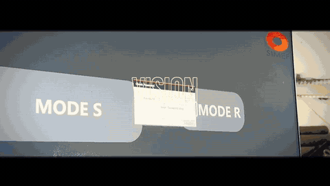
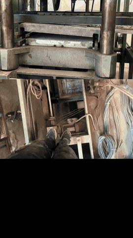
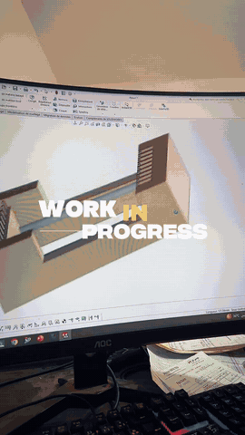

<h1 align="center">Ayhem Belkhamsa</h1>
<p align="center"><b>Industrial Automation Engineer &amp; Machine Builder</b> — Bizerte · Menzel Bourguiba · Tunisia</p>

<p align="center">
  <a href="https://ayhem-b.github.io/Ayhem-portfolio/"></a>
  <a href="mailto:belkhamsaayhem09@gmail.com"></a>
</p>
<p align="center">
  <a href="https://tn.linkedin.com/in/ayhem-belkhamsa-976b50333"></a>
  <a href="https://www.instagram.com/ayhem_belkhamsa/"></a>
  <a href="https://www.facebook.com/ayhem.belkh/"></a>
  
</p>

<p align="center">
  
  <br>
  <sub>Vision inspection station I built for a production line — camera bracket designed in CAD, inspection logic in VisionMaster + C#.</sub>
</p>

I retrofit, build and commission special machines for factories in northern Tunisia — from PLC cabinets rewired from scratch to vision-guided robots running in production. Independent operator: the person who diagnoses the line, quotes the job and builds it is the same person.

**What I do**

| ⏚ PLC &amp; cabinet retrofits | ⚙ Custom machines | ◎ Vision &amp; robotics | &gt;_ HMI &amp; data |
|---|---|---|---|
| Trace undocumented wiring, rebuild the cabinet, reprogram from a known-good baseline. Mitsubishi FX / Coolmay, Siemens S7. | Test rigs and one-off equipment sized to the real process, with an interface operators can run on day one. | Pick &amp; place, 6-axis arms, Delta robots, machine vision QC (VisionMaster, OpenCV), edge AI on Jetson. | C# (.NET / WinForms / WPF) HMIs, live logging, PDF reporting, Django back-ends, MQTT / Modbus / Snap7. |

## Featured projects

<table>
<tr>
<td width="50%" valign="top">
<br>
<b>Material tensile testing machine</b> · <a href="https://github.com/ayhem-b/Stress-Machine-Machine-de-traction">overview</a> · 🔒 source on request<br>
<sub>Built the rig and wrote its C# WinForms HMI: Mitsubishi FX PLC over MX Component, live stress/strain curve, servo speed control, PDF test reports (iTextSharp). .NET Framework 4.7.2.</sub>
</td>
<td width="50%" valign="top">
<br>
<b>ILLIG RV74 thermoformer retrofit</b> · 🔒 private (client project)<br>
<sub>Full control retrofit of a 1993 ILLIG RV74: Coolmay M302 (FX3U-compatible) PLC, GX Works2 structured project, 128 DI / 64 DO / 64 TC I/O allocation rebuilt from the original wiring diagrams, 14 heater zones. In progress.</sub>
</td>
</tr>
<tr>
<td width="50%" valign="top">
<br>
<b>SIMEF vision detection system</b> · 🔒 private (client project)<br>
<sub>Hikrobot VisionMaster inspection with C# scripts: marking detection, OK/NG decision, per-product counters, two operating modes. 3D-printed camera, lighting and baffle supports designed in SolidWorks.</sub>
</td>
<td width="50%" valign="top">
<br>
<b>GMAO — maintenance management web app</b> · <a href="https://github.com/ayhem-b/GMAO">repo</a><br>
<sub>Django CMMS with work orders, interventions, spare parts and a live machine-status dashboard fed by a Siemens S7-1200 over Snap7. Capstone project at Lear Corporation Tunisia (ISET Bizerte).</sub>
</td>
</tr>
<tr>
<td width="50%" valign="top">
<b>Smart home IoT stack</b> · 🔒 private (academic project)<br>
<sub>Mosquitto → Node-RED rule engine → InfluxDB → Grafana, all in Docker Compose, with a Python sensor simulator that runs an accelerated "day" and an ESP32 path for real sensors. 8 rule families (air quality, temperature, humidity, smoke, pool level, presence, soil moisture, rain).</sub>
</td>
<td width="50%" valign="top">
<b>Titanic survival prediction</b> · <a href="https://github.com/ayhem-b/Ttitanic_predicton">repo</a><br>
<sub>KNN and logistic regression in Orange and Python (scikit-learn), up to 83 % accuracy on the held-out set, with a Typst report.</sub>
</td>
</tr>
</table>

<p align="center">
  
  &nbsp;&nbsp;
  
</p>

## Toolbox

**PLC &amp; motion** &nbsp;


**Vision &amp; robotics** &nbsp;


**Software** &nbsp;


Currently learning **ROS 2** and going deeper on industrial communication protocols.

## GitHub activity

<p align="center">
  
  
</p>

[](https://wakatime.com/@cf8da79b-a470-449f-8b0c-f235c18b2fd3)
<!--START_SECTION:waka-->

```txt
From: 23 October 2026 - To: 30 October 2026

No activity tracked
```

<!--END_SECTION:waka-->

<p align="center">
  
  
</p>

---

<p align="center"><sub>Have a line that's down, a machine nobody documented, or a process that's still manual? <a href="https://ayhem-b.github.io/Ayhem-portfolio/#contact">Let's scope it out.</a></sub></p>
